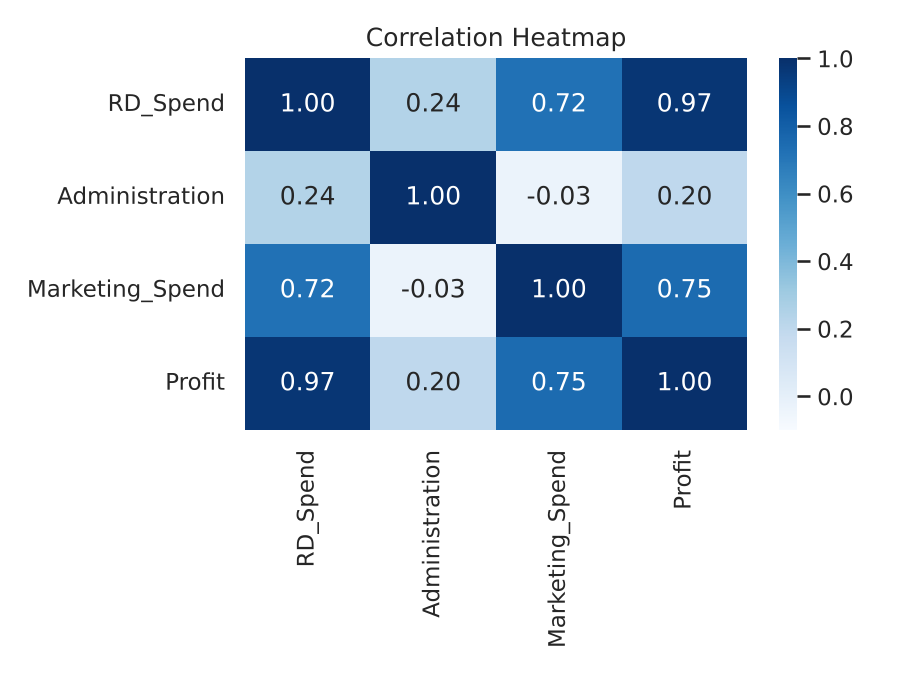
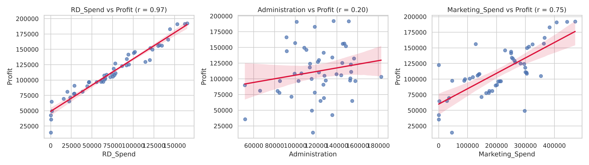
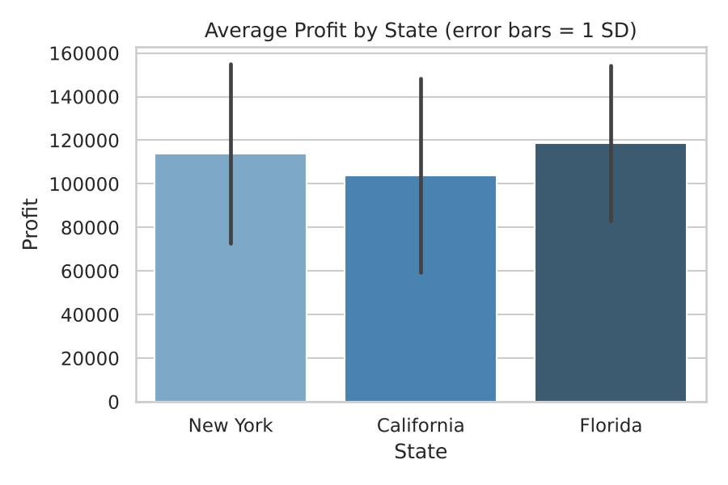
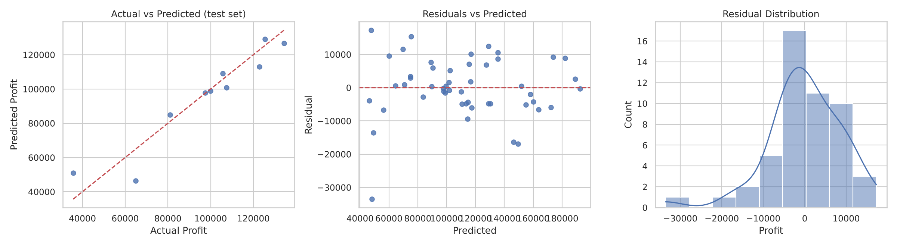

# Startup Profit Analysis

Which spending drives a startup's profit: **R&D, Administration or Marketing**? This project answers that with Python (EDA + Multiple Linear Regression) and a Power BI dashboard.

## Key Results

| Metric | Value |
|---|---|
| Strongest driver | **R&D Spend** (correlation 0.97) |
| Hold-out R² (80:20 split) | 0.90 |
| 5-fold cross-validated R² | **0.93** (±0.04) |
| Mean absolute error | ≈ 7,000 profit units |
| Multicollinearity (VIF) | All < 2.5 (no issue) |



## Objectives

- Analyze the relationship between startup expenses and profit.
- Identify the most influential spending factor.
- Compare average profit across states.
- Build a Multiple Linear Regression model to predict profit.
- Present business insights through a Power BI dashboard.

## Dataset

- 50 startup records, 5 columns: `RD_Spend`, `Administration`, `Marketing_Spend`, `State`, `Profit`
- States: New York (17), California (17), Florida (16)
- No missing values or duplicates
- File: `profit_analysis_startup.csv`
- This is the widely used "50 Startups" practice dataset.

## Methodology

1. Data loading, inspection and validation
2. Exploratory Data Analysis (scatter plots, heatmap, state-wise summary)
3. Multiple Linear Regression (80:20 split, `random_state=42`)
4. Model evaluation: R², MAE, RMSE, 5-fold cross-validation, VIF, residual analysis
5. Test whether adding `State` improves the model
6. Profit prediction for new startups
7. Power BI dashboard

## Findings

**Spend vs profit**



- **R&D Spend** has a very strong positive correlation with profit (0.9729). Each extra unit of R&D is associated with ≈ 0.80 extra profit (holding other spend constant).
- **Marketing Spend** is moderately correlated (0.7478), but it is also correlated with R&D (0.72), so its independent effect is small (coefficient ≈ 0.03).
- **Administration** is weakly correlated (0.2007) and its coefficient is slightly negative.

**State-wise profit**



| State | Startups | Avg Profit |
|---|---|---|
| Florida | 16 | 118,774 |
| New York | 17 | 113,756 |
| California | 17 | 103,905 |

Florida has the highest average, but the gap is small compared with the spread inside each state, and adding State to the model did not improve cross-validated R² (0.928 with State vs 0.934 without).

**Model quality**



- Residuals are centred on zero with no strong pattern.
- The largest error is a startup with zero R&D spend and very low profit, which the model over-predicts.
- With only 10 test rows, hold-out R² varies a lot between splits (0.80 to 0.99 across 100 random splits), so cross-validated R² (0.93) is the more reliable figure.

## Business Insights

- R&D investment is the clearest lever for higher profit.
- Marketing spend should be judged on return on investment, as it adds little beyond R&D.
- Administrative spend shows no positive link with profit and should be monitored.
- State alone is not a strong predictor of profit.

## Limitations

- Small dataset (50 rows).
- The model assumes a linear relationship.
- Predictions outside the observed spending ranges are unreliable.

## Power BI Dashboard

> Add your dashboard screenshot here: ``
> and upload the `.pbix` file to this repository.

## How to Run

```bash
git clone https://github.com/jadisrikanth123-prog/startup-profit-analysis.git
cd startup-profit-analysis
pip install -r requirements.txt
jupyter notebook Profit_analysis.ipynb
```

## Project Files

| File | Description |
|---|---|
| `Profit_analysis.ipynb` | EDA, regression model, evaluation and prediction |
| `profit_analysis_startup.csv` | Dataset |
| `images/` | Charts used in this README |
| `requirements.txt` | Python dependencies |

## Tools

Python · Pandas · NumPy · Matplotlib · Seaborn · Scikit-learn · Jupyter · Power BI

## Author

**Srikanth Jadi** - Aspiring Data Analyst | Python | SQL | Excel | Power BI
